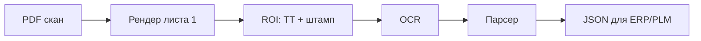

  

# 05 · OCR чертежей → структурированные данные

## Проблема
Сканы чертежей (PDF без текстового слоя) живут в архиве, а технические требования, паспорт и поля штампа приходится переносить в ERP/PLM вручную. Ошибки и задержки на разборе первого листа.

## Роль
Backend / document-AI инженер — HTTP API, пайплайн PDF→ROI→OCR→parse, Docker, контракт JSON для интеграции.

## Что сделал
Микросервис извлечения с первого листа чертежа:
- рендер PDF (PyMuPDF) с настраиваемым DPI
- эвристическая детекция зон ТТ и основной надписи (ГОСТ-раскладка, без жёстких пикселей под один формат)
- OCR (Tesseract `rus+eng`) за протоколом `OcrEngine` — можно сменить движок без смены API
- парсинг нумерованных ТТ, паспорта, обозначения, массы, масштаба, листов
- REST: `POST /v1/drawings/extract` → структурированный JSON + `meta.warnings` / confidence
- health/ready, лимит upload, Docker Compose как основной деплой

## Ограничения
- v1: только первый лист (ТТ + штамп), без геометрии и спецификаций на других листах
- качество зависит от скана; частичный успех — HTTP 200 с warnings, не «тихий» провал
- без хранения PDF/результатов в БД и без LLM как основного движка

## Поток

## Стек
Python, FastAPI, Pydantic, PyMuPDF, Tesseract, Docker Compose

## Связанные приватные репо
`drawing-ocr-service`

## Результат
Чертёж по API превращается в машиночитаемые поля (ТТ, паспорт, штамп) с явной диагностикой качества — готово к подключению в производственный контур.
